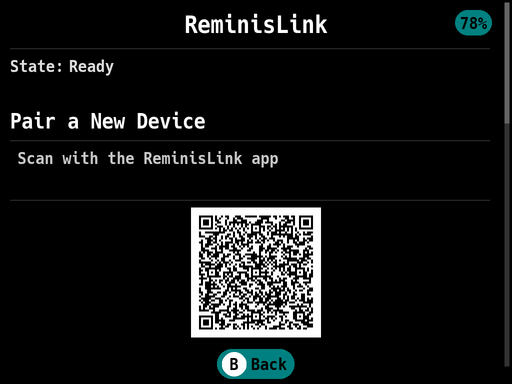
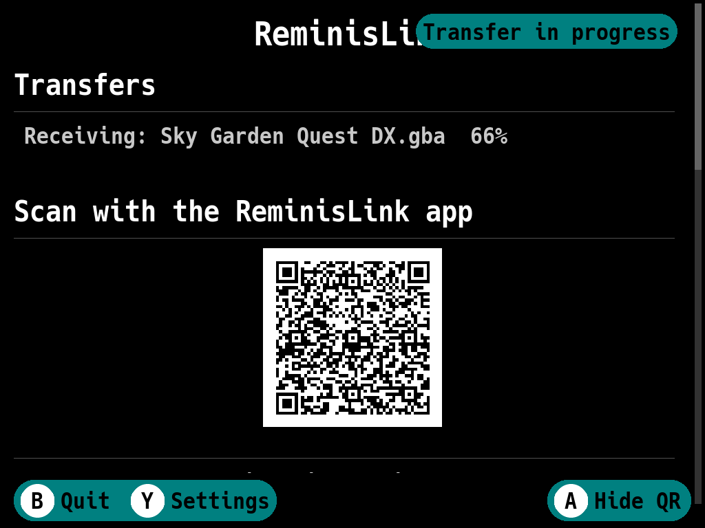
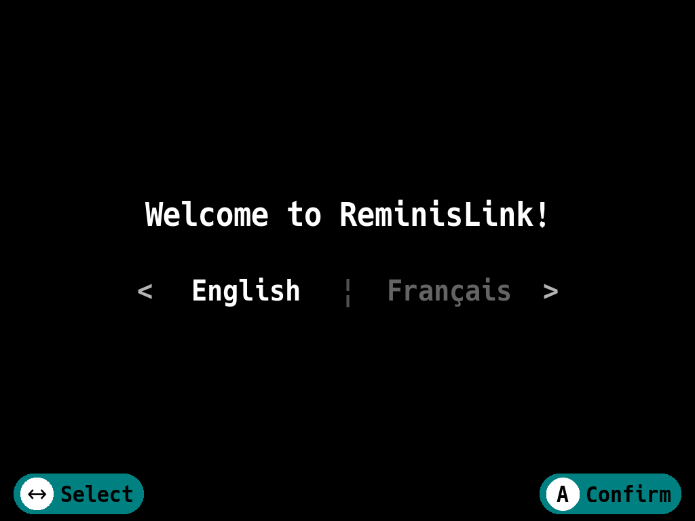

<p align="center">
  
</p>

<h1 align="center">ReminisLink</h1>

<p align="center">Your iPhone, companion of your retro handheld.</p>

<p align="center">
  <a href="https://github.com/tfournier/ReminisLink/actions/workflows/ci.yml"></a>
  <a href="https://github.com/tfournier/ReminisLink/releases/latest"></a>
  <a href="LICENSE"></a>
</p>

<p align="center">
  <a href="https://apps.apple.com/us/app/reminislink/id6837216406">App Store</a> ·
  <a href="https://reminis.link">Website</a> ·
  <a href="https://reminis.link/install/">Installation</a> ·
  <a href="https://reminis.link/support/">Support</a>
</p>

ReminisLink lets you manage the games on your retro handheld from your iPhone: ROMs, saves, save states, cheats and ROM patches. Bring your own files: ReminisLink does not provide or find any game.

It has two parts:

- **The pak**: the ReminisLink program for the handheld (NextUI on the TrimUI Brick; other NextUI handhelds and Knulli are experimental), shown as "ReminisLink" in the Tools menu. You open it, manage your games from the phone, close it and play.
- **ReminisLink for iOS**: the iPhone app. It finds the handheld on the local Wi-Fi network (Bonjour), pairs with a QR code and talks to the pak over HTTPS, pinned to the fingerprint of the certificate's public key (SPKI) carried by the QR code. The app and the pak only talk over your local network (save copies can go to your iCloud Drive); the pak never connects to the internet.



## Features of the pak

- Pairing with a QR code only (no PIN), valid 10 minutes, open only while the code is on screen: on the main screen until a first device is paired, then from Settings > Pair a New Device. Several devices can be paired. Every request except `GET /hello` and `POST /pair` (which proves the one-time secret of the QR code) is signed with the device's Ed25519 key: only paired devices are accepted. Pairings made by earlier test builds (before M13) are deleted at the first launch: pair again.
- Shows its state (Ready, Connected, Transfer in progress), the battery level, the connected devices, the transfers with their progress, and a short banner each time the SD card changes ("Save restored: ...").
- Send ROMs and game art, back up and restore saves, lock save states, edit cheats and apply IPS, BPS and UPS patches, all from the app.
- Nothing is deleted without a copy: a deleted or replaced file goes to a trash, purged at launch once an entry reaches 30 days of counted age (the clock of the console is not trusted).
- Settings: pair a new device, name of the console (as seen by the app), paired devices, language, version and log location.
- Interface in English and French, chosen on first launch.

| Transfer in progress | Settings | Pair a New Device | First launch |
|---|---|---|---|
|  |  |  |  |

The screenshots come from the desktop mode (`make screenshots`); on the console the pak uses the NextUI theme.

## Installation

### Compatible handhelds

| Handheld | Firmware | Status |
|---|---|---|
| TrimUI Brick (`tg5040`) | NextUI | Supported, tested on the device |
| TrimUI Smart Pro S (`tg5050`) | NextUI | Experimental, looking for testers |
| Anbernic H700 handhelds (`h700`: RG28XX, RG34XX, RG35XX Plus/H/Pro/SP, RG40XX H/V, RG CubeXX) | NextUI | Experimental, looking for testers |
| Miyoo Flip (`my355`) | NextUI | Experimental, looking for testers |
| Handhelds running Knulli | Knulli | Experimental, looking for testers |

The experimental handhelds come with the next release of the pak (1.1). The app runs on iPhone, iPad and Macs with Apple silicon (iOS 18 or later).

### Call for testers

The experimental handhelds have never been tried on a real device. The pak is built for them and tested without them: the card layouts are rebuilt from the firmware source code, and the server runs in each system under emulation. The screen, the buttons and the Wi-Fi are untested. If you own one of these handhelds, please try ReminisLink and fill in a [handheld test report](https://github.com/tfournier/ReminisLink/issues/new?template=handheld_test.yml) with:

- your handheld, its firmware and the firmware version;
- what works and what does not: the pak opens and shows the QR code, the app pairs, the library and the dashboard load, a game upload works, a save backup and restore work;
- the logs of the pak, `ReminisLink.txt` and `ReminisLink.stderr.txt`, in `/.userdata/<platform>/logs/` (NextUI) or `/userdata/system/logs/` (Knulli). They contain neither the pairing secret nor a private key, but read them before attaching them: they may show the name of the handheld and of your Wi-Fi network.

Back up your SD card first. ReminisLink keeps a copy of everything it replaces or deletes, but this is a test version. Step-by-step instructions, in French, are in [docs/appel-testeurs.md](docs/appel-testeurs.md).

**Install:** both zips, `ReminisLink.pak.zip` and `ReminisLink.knulli.zip`, are attached to each release and pre-release of the pak from `v1.1.0-beta.1` on: take the latest pre-release (`vX.Y.Z-beta.N`) on the [releases page](https://github.com/tfournier/ReminisLink/releases).
- **NextUI** (`tg5050`, `h700`, `my355`): unzip the same `ReminisLink.pak.zip` as for the Brick into `/Tools/<platform>/`, so that you get `/Tools/<platform>/ReminisLink.pak/launch.sh`.
- **Knulli**: unzip `ReminisLink.knulli.zip` into `/userdata/roms/tools/`, then open **Tools > ReminisLink**. On Knulli, cheats and tool paks are not available, and the data of ReminisLink is in `/userdata/system/ReminisLink`.

### From the Pak Store

Open **Pak Store** on your device and install **ReminisLink**.

### Manually

1. Download `ReminisLink.pak.zip` from the [latest release](https://github.com/tfournier/ReminisLink/releases/latest).
2. Unzip it on your computer: Finder or Windows creates a `ReminisLink.pak` folder (if your tool extracts the files loose, create a `ReminisLink.pak` folder and put them in it). Copy that folder into `/Tools/tg5040/` on your SD card. You should get `/Tools/tg5040/ReminisLink.pak/launch.sh`.
3. Open **Tools > ReminisLink** on your device.

## Usage

1. Turn on Wi-Fi in the NextUI settings, then open **Tools > ReminisLink** on the handheld. The iPhone must be on the same Wi-Fi network.
2. In the ReminisLink app, tap **Add a Console**, scan the QR code shown by the pak, then tap **Open the Console**.
3. Manage your games from the app. When you are done, press **B** on the handheld to close the pak, and play.

The pak only runs when no game is running: open it from the Tools menu when you need it.

| Screen | Buttons |
|---|---|
| Main screen | **A** hide or show the QR code · **Y** settings · **B** quit (asks first if a transfer is in progress) |
| Lists | **A** select · **B** back |
| Keyboard (console name) | **START** confirm · **Y** cancel |

### Where are the files?

The pak changes your files where NextUI expects them, and keeps its own data in `/.userdata/shared/ReminisLink/`.

| File | Location |
|---|---|
| ROMs | `/Roms/<System> (<TAG>)/<rom.ext>` |
| Saves | `/Saves/<TAG>/<rom.ext>.sav` |
| Save states | `/.userdata/shared/<TAG>-<core>/<rom.ext>.st<N>` |
| Cheats | `/Cheats/<TAG>/<rom.ext>.cht` |
| Settings (device id, name, language) | `/.userdata/shared/ReminisLink/config.json` |
| Paired devices | `/.userdata/shared/ReminisLink/clients.json` |
| Save backups, resume history, state locks | `/.userdata/shared/ReminisLink/backups/` and `locks/` |
| Trash (deleted or replaced files, purged at 30 days of counted age) | `/.userdata/shared/ReminisLink/trash/` |
| Patches you copy to the card | `/.userdata/shared/ReminisLink/patches/` |
| Logs | `/.userdata/tg5040/logs/ReminisLink.txt`, `ReminisLink.ui.txt` and `ReminisLink.stderr.txt` |

`clients.json` holds, for each paired device, its identifier, name, platform, the types of device seen, its public key and the pairing date; no private key, so a copy of the SD card cannot sign requests for them. The `tls/` folder holds the private key of the pak's certificate: with a copy of the card, someone could pretend to be the handheld on the local network. If you lend or lose the card, use **Settings > Forget all devices**, and delete `tls/` to get a new certificate at the next launch (every device then has to pair again).

## Development

```
ReminisLink/
├── go.mod                 # Go module of the pak
├── cmd/reminislink/       # pak entry point (console, --desktop, --headless)
├── internal/              # pak packages (app lifecycle, server, auth, OS adapters, storage, ui, l10n...)
├── pak/                   # launch.sh and files shipped in the pak
├── pak.json               # Pak Store manifest (version, changelog)
├── ios/                   # Xcode project of the iOS app (SwiftUI)
├── android/               # Gradle project of the Android app (Kotlin, Compose; milestone M21, in progress)
├── protocol/              # OpenAPI contract and shared test vectors (Go, Swift, Kotlin)
├── scripts/               # toolchain setup, screenshots, device checks
├── docs/specs/            # functional and technical specifications (French)
└── prompts/               # prompts for the AI coding agents (French)
```

The UI uses [gabagool](https://github.com/BrandonKowalski/gabagool), like Cheat Manager and the Pak Store. Its screens build with the `sdl` Go build tag (cgo and SDL2); everything else is pure Go and builds with `CGO_ENABLED=0`.

### Running the pak on a Mac

Headless (server and Bonjour, no UI, no SDL):

```sh
make headless                  # server + Bonjour on a temporary copy of testdata/sdcard
dns-sd -B _reminislink._tcp    # the pak is announced on the local network
echo '<pairing link printed by make headless>' | scripts/smoke.sh   # pair, then a signed GET /systems
```

The headless mode prints the pairing link and a QR code in the
terminal (stdout only, never in the log). `HEADLESS_ARGS="--port 48000 --name Test" make headless` changes the
port and the name for that run.

With the UI in a window (keyboard: arrows, `a`, `b`, `x`, `y`, `Return` = START):

```sh
brew install pkg-config sdl2 sdl2_ttf sdl2_image sdl2_gfx   # once
make desktop
```

On macOS the desktop window shows no QR code: the QR image holds the
pairing secret and is only drawn from memory (Linux `memfd`), never from a
file that could stay on the disk. To pair, use `make headless`, which prints
the QR code in the terminal.

`make screenshots` regenerates `docs/screenshots/` with the desktop UI under Xvfb in Docker (no SDL needed on the Mac).

### Build

The binary is cross-compiled for ARM64 against Debian 11 (bullseye) libraries, which is old enough for the TrimUI firmware. The easiest way to build is with Docker:

```sh
make docker-release      # builds dist/ReminisLink.pak.zip
```

| Target | Description |
|---|---|
| `make test` | Go unit tests. Pure Go, no toolchain needed. |
| `make lint` | `gofmt` and `go vet`. |
| `make fuzz` | Short fuzzing of the patch parsers (`FUZZTIME`). |
| `make contract` | Validates `protocol/openapi.yaml` (Redocly in Docker) and checks the test vectors. |
| `make build` / `pak` / `release` | Cross-compile, assemble the pak, build the zip (one ARM64 binary and one zip for every NextUI platform). They need the toolchain of `scripts/setup-toolchain.sh`. |
| `make knulli-release` | Builds `dist/ReminisLink.knulli.zip` (experimental). |
| `make emulation` | Runs the pak headless on the card layout of each platform and of Knulli, in a linux/arm64 container with the glibc of each firmware (Docker; `LAYOUTS="h700 knulli"` to choose). With `build/reminislink` present (`make docker-build`), also checks the glibc it needs. |
| `make docker-<target>` | Runs any target inside the build image. |
| `make vX.Y.Z` | Releases a version of the pak; `make vX.Y.Z-beta.N` a pre-release (see below). |
| `make ios-vX.Y.Z` | Releases the iOS app; `make ios-vX.Y.Z-beta.N` a TestFlight pre-release, tagged `ios-beta-vX.Y.Z-beta.N` (see below). |
| `make release-checks` | Tests the release scripts (tag rules, Xcode Cloud scripts, App Store "What's New"). |

iOS: `cd ios/ReminisLinkKit && swift test`, and `cd ios && xcodebuild test -scheme ReminisLink -destination 'platform=iOS Simulator,name=iPhone 16'`.

### Android app (in progress)

The Android app (milestone M21, `docs/specs/10-app-android.md`) lives in `android/`: a pure Kotlin `:core` module (protocol, signing, pairing, TLS pin, API client) and a Jetpack Compose `:app` module. It uses no proprietary Google library (no Play Services, ML Kit or Firebase), so it can be published on F-Droid. The first increment pairs with a console (QR code or pasted link), shows its dashboard and browses its library read-only.

Needs a JDK 17+ and the Android SDK (`ANDROID_HOME`, or `sdk.dir` in `android/local.properties`):

```sh
make android-test              # :core unit tests (reads protocol/test-vectors in place) and :app unit tests
make android-build             # debug APK in android/app/build/outputs/apk/debug/
android/scripts/pak-e2e.sh     # with an emulator running: pair with `make headless` and browse its library
```

### Translations

Messages are declared once, in English, in `internal/l10n/messages.go`. Each language has a file in `internal/l10n/locales/active.<lang>.toml`. To add or fix a translation, edit or create `active.<lang>.toml` with the same keys and the same `{{.Variables}}`, add a new language to `Languages` in `internal/l10n/l10n.go`, and run `make test`: the tests check that every language has every message.

### Releasing

The pak and the iOS app are released from this repository with their own version numbers and tags:

| Tag | Releases | Built by |
|---|---|---|
| `vX.Y.Z` | the pak: GitHub release marked "Latest", read by the Pak Store | GitHub Actions |
| `vX.Y.Z-beta.N`, `vX.Y.Z-rc.N` | a pak pre-release for testers: GitHub "Pre-release", ignored by the Pak Store | GitHub Actions |
| `ios-vX.Y.Z` | the app: App Store version `X.Y.Z`, submitted to App Review (Submit workflow started by hand), released automatically once approved | Xcode Cloud |
| `ios-beta-vX.Y.Z-beta.N`, `ios-beta-vX.Y.Z-rc.N` | an app pre-release: TestFlight only (App Store version `X.Y.Z`, a new build number) | Xcode Cloud |

Only a pak release can be "Latest" on GitHub: app tags never start the GitHub workflow, and its release job refuses any tag that is not a pak version (`make release-checks` tests these rules).

**Nothing is released unless the tests pass.** `make vX.Y.Z`, `make ios-vX.Y.Z` and `make android-vX.Y.Z` (pre-releases too) refuse to tag unless the [CI workflow](.github/workflows/ci.yml) passed on `HEAD` itself (a run for a push to `main`, never a tag; read with `gh`; only the conclusion `success` counts): the jobs `go`, `contract`, `build` and `emulation` for the pak, `ios`, `ios-ui-1`, `ios-ui-2` and `contract` for the iOS app, `android` for the Android app. They say whether the CI is still running, failed or never ran on that commit; push, wait for the CI, then run the target again. Then the builds check again: the pak's release job needs those same jobs on the tag, the Android release workflow runs the unit tests and lint before it builds and signs the APK, and Xcode Cloud (`ios/ci_scripts/ci_post_clone.sh`) stops before the archive unless the jobs `ios`, `ios-ui-1`, `ios-ui-2` and `contract` passed on `main` for the commit it builds (public GitHub API; no network or rate limit also stops it; the commit `Release app X.Y.Z` that `make ios-vX.Y.Z` pushes with its tag is judged by its parent while its own CI runs, see [ios/README.md](ios/README.md)). `RL_SKIP_CI_CHECK=1` (on the `make` command line, or as an Xcode Cloud environment variable) skips these checks with a warning: for one exceptional release only, never by default. The app's changelog is [ios/CHANGELOG.md](ios/CHANGELOG.md) and its release procedure, Xcode Cloud setup included, is in [ios/README.md](ios/README.md#release-testflight-and-app-store).

#### The pak

`pak.json` is the single source of the version and of the changelog. The Pak Store shows the changelog, and the GitHub release uses it as release notes.

1. Update the `"Unreleased"` entry in the `changelog` of `pak.json`, and commit it like any other change.
2. From an up-to-date `main` branch with no uncommitted changes, run `make v1.2.3`. This runs the lint and the tests, renames `Unreleased` to `v1.2.3` in `pak.json`, sets `version`, commits as `Release v1.2.3`, tags `v1.2.3` and pushes both.

`platforms` in `pak.json` lists only the platforms the latest published zip supports: the Pak Store reads `pak.json` from `main` and offers that zip on each platform listed. A new platform goes into `platforms` in the release commit of the first stable release whose zip supports it (tg5050, h700 and my355: the first release with milestone M20, v1.1.0), never before.

The [CI workflow](.github/workflows/ci.yml) then builds the pak and publishes the GitHub release with `ReminisLink.pak.zip`. The Pak Store reads `pak.json` from this repository and downloads `<repo_url>/releases/download/<version>/<release_filename>`, which is why the tag, the `pak.json` version and the release file name must match.

A pre-release: with an `"Unreleased"` entry in `pak.json`, run `make v1.2.3-beta.1` (or `-rc.1`) from `main`. It runs the lint and the tests, then tags and pushes the tag only: `pak.json` is not changed, so the Pak Store keeps offering the last release. The CI publishes a GitHub release marked "Pre-release" (never "Latest") with the `Unreleased` notes and `ReminisLink.pak.zip`, whose `pak.json` and reported `pakVersion` name the pre-release.

#### The app

Update the `## Unreleased` section of `ios/CHANGELOG.md` (English and French, the App Store "What's New") with each change of the app, and run `ios/ci_scripts/release_notes.sh sync` (the CI checks it). Then, from `main`:

- `make ios-v1.2.3-beta.1`: tags `ios-beta-v1.2.3-beta.1` and pushes it; Xcode Cloud sends version 1.2.3 to TestFlight.
- `make ios-v1.2.3`: renames `## Unreleased` to `## 1.2.3`, syncs the App Store texts, commits as `Release app 1.2.3`, tags `ios-v1.2.3` and pushes; the Xcode Cloud Release workflow builds it and prepares the App Store version. Once TestFlight shows that build, start the Submit workflow by hand on the tag: it submits the build of the Release run to App Review (see [ios/README.md](ios/README.md), "Xcode Cloud").

## Documentation

- [Specifications](docs/specs/README.md)
- [Agent prompts](prompts/README.md)
- [Conventions for coding agents](CLAUDE.md)

## Built with AI

ReminisLink is developed with the help of AI coding assistants (Claude Code, with independent reviews by other models). The project owner sets the direction, decides, tests on real hardware and is responsible for what is published. Every change goes through automated tests and an independent review before it is merged; the review notes are kept in [docs/reviews/](docs/reviews/) and the working rules for the agents in [CLAUDE.md](CLAUDE.md) and [prompts/](prompts/README.md).

## License

[MIT](LICENSE). Third-party components of the pak are listed in [pak/THIRD_PARTY.md](pak/THIRD_PARTY.md).

The name ReminisLink and its icon are not covered by the license: forks must use another name and icon.
