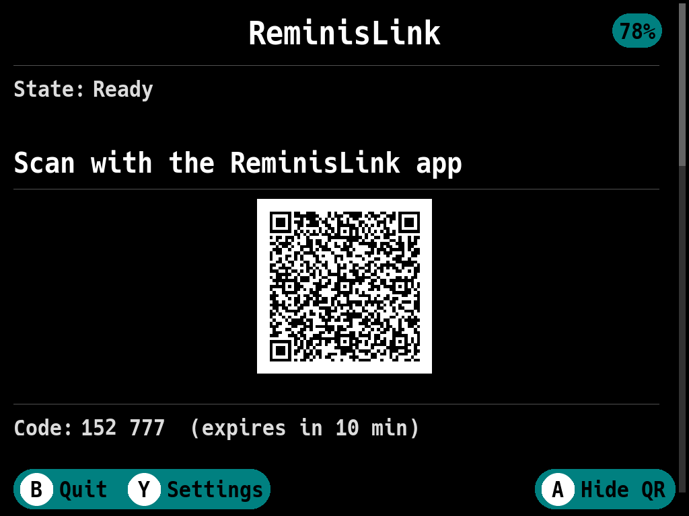
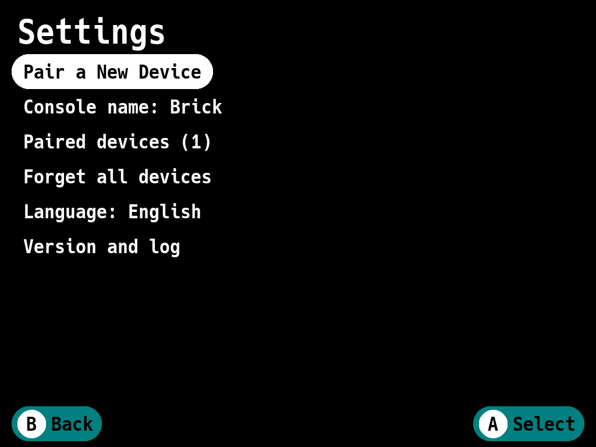

# ReminisLink

ReminisLink lets you manage the games on your retro handheld from your iPhone: ROMs, saves, save states, cheats and ROM patches. Bring your own files: ReminisLink does not provide or find any game.

It has two parts:

- **The pak**: the ReminisLink program for the handheld (NextUI on the TrimUI Brick first), shown as "ReminisLink" in the Tools menu. You open it, manage your games from the phone, close it and play.
- **ReminisLink for iOS**: the iPhone app. It finds the handheld on the local Wi-Fi network (Bonjour), pairs with a QR code and talks to the pak over HTTP. Everything stays on your local network.



## Features of the pak

- Pairing with a QR code, or with a 6-digit PIN, valid 10 minutes, open only while the code is on screen: on the main screen until a first device is paired, then from Settings > Pair a New Device. Requests are signed: only paired iPhones are accepted.
- Shows its state (Ready, Connected, Transfer in progress), the battery level, the connected devices, the transfers with their progress, and a short banner each time the SD card changes ("Save restored: ...").
- Send ROMs and game art, back up and restore saves, lock save states, edit cheats and apply IPS, BPS and UPS patches, all from the app.
- Nothing is deleted without a copy: a deleted or replaced file goes to a trash kept 30 days.
- Settings: pair a new device, name of the console (as seen by the app), paired devices, language, version and log location.
- Interface in English and French, chosen on first launch.

| Transfer in progress | Settings | Pair a New Device | First launch |
|---|---|---|---|
|  |  |  |  |

The screenshots come from the desktop mode (`make screenshots`); on the console the pak uses the NextUI theme.

## Installation

The pak needs NextUI on a TrimUI Brick (platform `tg5040`).

### From the Pak Store

Open **Pak Store** on your device and install **ReminisLink**.

### Manually

1. Download `ReminisLink.pak.zip` from the [latest release](https://github.com/tfournier/ReminisLink/releases/latest).
2. Unzip the archive into `/Tools/tg5040/` on your SD card. You should get `/Tools/tg5040/ReminisLink.pak/launch.sh`.
3. Open **Tools > ReminisLink** on your device.

## Usage

1. Turn on Wi-Fi in the NextUI settings, then open **Tools > ReminisLink** on the handheld. The iPhone must be on the same Wi-Fi network.
2. In the ReminisLink app, scan the QR code shown by the pak (or type the PIN).
3. Manage your games from the app. When you are done, press **B** on the handheld to close the pak, and play.

The pak only runs when no game is running: open it from the Tools menu when you need it.

| Screen | Buttons |
|---|---|
| Main screen | **A** hide or show the QR code · **Y** settings · **B** quit (asks first if a transfer is in progress) |
| Lists | **A** select · **B** back |
| Keyboard (console name) | **START** confirm · **Y** cancel |

### Where are the files?

The pak changes your files where NextUI expects them, and keeps its own data in `/.userdata/shared/ReminisLink/`.

| File | Location |
|---|---|
| ROMs | `/Roms/<System> (<TAG>)/<rom.ext>` |
| Saves | `/Saves/<TAG>/<rom.ext>.sav` |
| Save states | `/.userdata/shared/<TAG>-<core>/<rom.ext>.st<N>` |
| Cheats | `/Cheats/<TAG>/<rom.ext>.cht` |
| Settings (device id, name, language) | `/.userdata/shared/ReminisLink/config.json` |
| Paired devices | `/.userdata/shared/ReminisLink/clients.json` |
| Save backups, resume history, state locks | `/.userdata/shared/ReminisLink/backups/` and `locks/` |
| Trash (deleted or replaced files, kept 30 days) | `/.userdata/shared/ReminisLink/trash/` |
| Patches you copy to the card | `/.userdata/shared/ReminisLink/patches/` |
| Logs | `/.userdata/tg5040/logs/ReminisLink.txt`, `ReminisLink.ui.txt` and `ReminisLink.stderr.txt` |

`clients.json` holds the keys of the paired devices: anyone who has the SD card in hand can read them. Use **Settings > Forget all devices** if you lend or lose the card.

## Development

```
ReminisLink/
├── go.mod                 # Go module of the pak
├── cmd/reminislink/       # pak entry point (console, --desktop, --headless)
├── internal/              # pak packages (app lifecycle, server, auth, OS adapters, storage, ui, l10n...)
├── pak/                   # launch.sh and files shipped in the pak
├── pak.json               # Pak Store manifest (version, changelog)
├── ios/                   # Xcode project of the iOS app (SwiftUI)
├── protocol/              # OpenAPI contract and shared test vectors (Go <-> Swift)
├── scripts/               # toolchain setup, screenshots, device checks
├── docs/specs/            # functional and technical specifications (French)
└── prompts/               # prompts for the AI coding agents (French)
```

The UI uses [gabagool](https://github.com/BrandonKowalski/gabagool), like Cheat Manager and the Pak Store. Its screens build with the `sdl` Go build tag (cgo and SDL2); everything else is pure Go and builds with `CGO_ENABLED=0`.

### Running the pak on a Mac

Headless (server and Bonjour, no UI, no SDL):

```sh
make headless                  # server + Bonjour on a temporary copy of testdata/sdcard
dns-sd -B _reminislink._tcp    # the pak is announced on the local network
echo '<pairing link printed by make headless>' | scripts/smoke.sh   # pair, then a signed GET /systems
```

The headless mode prints the pairing link, the PIN and a QR code in the
terminal (stdout only, never in the log). `HEADLESS_ARGS="--port 48000 --name Test" make headless` changes the
port and the name for that run.

With the UI in a window (keyboard: arrows, `a`, `b`, `x`, `y`, `Return` = START):

```sh
brew install pkg-config sdl2 sdl2_ttf sdl2_image sdl2_gfx   # once
make desktop
```

On macOS the desktop window shows the pairing PIN without the QR code: the
QR image holds the pairing secret and is only drawn from memory (Linux
`memfd`), never from a file that could stay on the disk. Pair with the PIN,
or use `make headless`, which prints the QR code in the terminal.

`make screenshots` regenerates `docs/screenshots/` with the desktop UI under Xvfb in Docker (no SDL needed on the Mac).

### Build

The binary is cross-compiled for ARM64 against Debian 11 (bullseye) libraries, which is old enough for the TrimUI firmware. The easiest way to build is with Docker:

```sh
make docker-release      # builds dist/ReminisLink.pak.zip
```

| Target | Description |
|---|---|
| `make test` | Go unit tests. Pure Go, no toolchain needed. |
| `make lint` | `gofmt` and `go vet`. |
| `make fuzz` | Short fuzzing of the patch parsers (`FUZZTIME`). |
| `make contract` | Validates `protocol/openapi.yaml` (Redocly in Docker) and checks the test vectors. |
| `make build` / `pak` / `release` | Cross-compile, assemble the pak, build the zip. They need the toolchain of `scripts/setup-toolchain.sh`. |
| `make docker-<target>` | Runs any target inside the build image. |
| `make vX.Y.Z` | Releases a version (see below). |

iOS: `cd ios/ReminisLinkKit && swift test`, and `cd ios && xcodebuild test -scheme ReminisLink -destination 'platform=iOS Simulator,name=iPhone 16'`.

### Translations

Messages are declared once, in English, in `internal/l10n/messages.go`. Each language has a file in `internal/l10n/locales/active.<lang>.toml`. To add or fix a translation, edit or create `active.<lang>.toml` with the same keys and the same `{{.Variables}}`, add a new language to `Languages` in `internal/l10n/l10n.go`, and run `make test`: the tests check that every language has every message.

### Releasing

`pak.json` is the single source of the version and of the changelog. The Pak Store shows the changelog, and the GitHub release uses it as release notes.

1. Update the `"Unreleased"` entry in the `changelog` of `pak.json`, and commit it like any other change.
2. From an up-to-date `main` branch with no uncommitted changes, run `make v1.2.3`. This runs the lint and the tests, renames `Unreleased` to `v1.2.3` in `pak.json`, sets `version`, commits as `Release v1.2.3`, tags `v1.2.3` and pushes both.

The [CI workflow](.github/workflows/ci.yml) then builds the pak and publishes the GitHub release with `ReminisLink.pak.zip`. The Pak Store reads `pak.json` from this repository and downloads `<repo_url>/releases/download/<version>/<release_filename>`, which is why the tag, the `pak.json` version and the release file name must match.

## Documentation

- [Specifications](docs/specs/README.md)
- [Agent prompts](prompts/README.md)
- [Conventions for coding agents](CLAUDE.md)

## License

[MIT](LICENSE). Third-party components of the pak are listed in [pak/THIRD_PARTY.md](pak/THIRD_PARTY.md).
